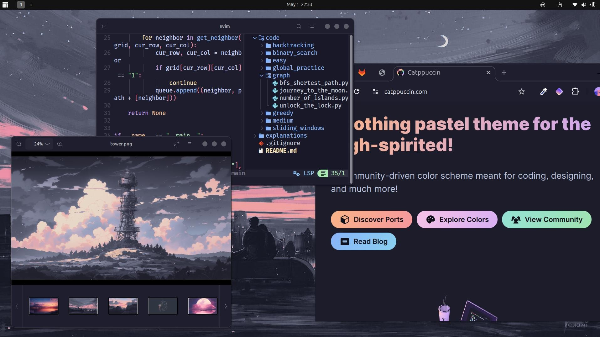

<a name="readme-top"></a>

<div align="center">
  <h1>Developer Dotfiles</h1>
  <p>
    Cross-platform development environment for Linux (Ubuntu/GNOME) and macOS.
    <br />
    Includes terminal, editor, AI coding assistant, and theme configurations.
  </p>
  <p>
    <a href="https://github.com/pallandir/dotfiles/issues">Report Bug</a>
    ·
    <a href="https://github.com/pallandir/dotfiles/issues">Request Feature</a>
  </p>
</div>

<br/>



## Overview

This repository contains dotfiles and automated setup scripts for a complete development environment on Linux and macOS.

### What's Included

| Component | Linux | macOS | Description |
|-----------|:-----:|:-----:|-------------|
| **Neovim** | ✓ | ✓ | Modern editor with LSP, Treesitter, and Mason |
| **Tmux** | ✓ | ✓ | Terminal multiplexer with Catppuccin theme |
| **ZSH** | ✓ | ✓ | Oh My Zsh with Jovial theme and plugins |
| **OpenCode** | ✓ | ✓ | AI coding assistant with specialized agents |
| **GTK Themes** | ✓ | - | Catppuccin theme for GTK-3/GTK-4 apps |
| **Aerospace** | - | ✓ | Tiling window manager for macOS |
| **Obsidian** | ✓ | ✓ | Note-taking app configuration |

<p align="right">(<a href="#readme-top">back to top</a>)</p>

## Project Structure

```
dotfiles/
├── linux/
│   └── install.sh          # Linux installation script
├── macos/
│   ├── install.sh          # macOS installation script
│   └── aerospace.toml      # Tiling window manager config
├── opencode/
│   ├── opencode.json       # OpenCode AI configuration
│   ├── agents/             # Specialized AI agents
│   ├── install.sh          # OpenCode config installer
│   └── README.md           # OpenCode documentation
├── tmux/
│   └── tmux.conf           # Tmux configuration
├── obsidian-config/        # Obsidian vault configuration
├── gtk-3.0/                # GTK-3 theme (Linux)
├── gtk-4.0/                # GTK-4 theme (Linux)
├── .themes/                # Shell themes (Linux)
└── .zshrc                  # ZSH configuration
```

<p align="right">(<a href="#readme-top">back to top</a>)</p>

## Quick Start

### Linux (Ubuntu)

```bash
git clone https://github.com/pallandir/dotfiles.git
cd dotfiles
./linux/install.sh
```

The script will install and configure:
- Base packages (git, curl, wget, build tools)
- Neovim (latest stable) with custom config
- Node.js, Python, Go, Rust toolchains
- Tmux with TPM and Catppuccin theme
- ZSH with Oh My Zsh and Jovial theme
- OpenCode AI with specialized agents
- GTK themes (Catppuccin)
- Flatpak with Flathub repository

### macOS

```bash
git clone https://github.com/pallandir/dotfiles.git
cd dotfiles
./macos/install.sh
```

The script will install and configure:
- Homebrew package manager
- iTerm2 terminal
- Neovim with custom config
- Tmux with TPM and Catppuccin theme
- ZSH with Oh My Zsh and Jovial theme
- OpenCode AI with specialized agents
- Aerospace tiling window manager

<p align="right">(<a href="#readme-top">back to top</a>)</p>

## Post-Installation

After running the install script:

1. **Restart your terminal** or run `source ~/.zshrc`

2. **Initialize Tmux plugins**:
   ```bash
   tmux
   # Press: Ctrl+a, then I (capital i)
   ```

3. **Configure OpenCode** (edit credentials):
   ```bash
   nano ~/.config/opencode/.env
   ```

4. **Verify Neovim**:
   ```bash
   nvim
   # Run :checkhealth
   ```

<p align="right">(<a href="#readme-top">back to top</a>)</p>

## Components

### Neovim

Custom configuration with:
- LSP support via Mason (auto-installs language servers)
- Treesitter for syntax highlighting
- Telescope for fuzzy finding
- Language support: Lua, Rust, Go, Python, TypeScript, Vue, and more

Configuration: `~/.config/nvim/`

### Tmux

Features:
- Prefix: `Ctrl+a`
- Catppuccin Mocha theme
- Session persistence (resurrect + continuum)
- Vim-style pane navigation (`h/j/k/l`)
- Quick splits: `|` (horizontal), `-` (vertical)
- OpenCode shortcut: `prefix + o`

Configuration: `~/.tmux.conf`

### ZSH

Plugins:
- git
- zsh-autosuggestions
- zsh-syntax-highlighting
- autojump
- bgnotify

Theme: [Jovial](https://github.com/zthxxx/jovial)

### OpenCode AI

Production-ready AI coding assistant with specialized agents:
- **backend** - Python, FastAPI, Pydantic, PostgreSQL
- **architect** - System design, documentation, cloud
- **ui** - React, Vue, Next.js, TypeScript, Tailwind
- **rust** - Rust systems programming
- **golang** - Go backend services
- **reviewer** - Code review
- **security** - Security audits
- **devops** - Docker, Kubernetes, CI/CD

See [opencode/README.md](./opencode/README.md) for detailed configuration.

### Aerospace (macOS only)

Tiling window manager with vim-like navigation:
- `Alt + h/j/k/l` - Focus windows
- `Alt + Shift + h/j/k/l` - Move windows
- `Alt + 1-9` - Switch workspaces
- `Alt + Shift + 1-9` - Move window to workspace

Configuration: `~/.config/aerospace/aerospace.toml`

<p align="right">(<a href="#readme-top">back to top</a>)</p>

## GTK Themes (Linux)

The Catppuccin theme is applied to:
- GTK-3.0 applications
- GTK-4.0 applications
- GNOME Shell
- Flatpak applications

To apply the shell theme, use [GNOME Tweaks](https://docs.rockylinux.org/desktop/gnome/gnome-tweaks/) and select the theme in Appearance.

### Recommended GNOME Extensions

- [Space Bar](https://github.com/christopher-l/space-bar) - Workspace indicator
- [Arc Menu](https://github.com/fishears/Arc-Menu) - Application launcher
- [Clipboard Indicator](https://github.com/Tudmotu/gnome-shell-extension-clipboard-indicator) - Clipboard manager
- [Vitals](https://github.com/corecoding/Vitals) - System monitor

<p align="right">(<a href="#readme-top">back to top</a>)</p>

## Obsidian

For note-taking, copy the Obsidian configuration to your vault:

```bash
cp -r obsidian-config/* /path/to/your/vault/.obsidian/
```

Includes theme and plugin configurations.

<p align="right">(<a href="#readme-top">back to top</a>)</p>

## Updating

To update your dotfiles after pulling changes:

```bash
cd ~/path/to/dotfiles
git pull

# Re-run the install script (idempotent)
./linux/install.sh   # or ./macos/install.sh
```

<p align="right">(<a href="#readme-top">back to top</a>)</p>

## License

Distributed under the GNU General Public License v3.0.

<p align="right">(<a href="#readme-top">back to top</a>)</p>

## Acknowledgments

- [Catppuccin](https://github.com/catppuccin) - Theme
- [Catppuccin Wallpapers](https://github.com/orangci/walls-catppuccin-mocha)
- [Oh My Zsh](https://github.com/ohmyzsh/ohmyzsh)
- [Jovial Theme](https://github.com/zthxxx/jovial)
- [Aerospace](https://github.com/nikitabobko/AeroSpace)
- [OpenCode](https://opencode.ai)

<p align="right">(<a href="#readme-top">back to top</a>)</p>
